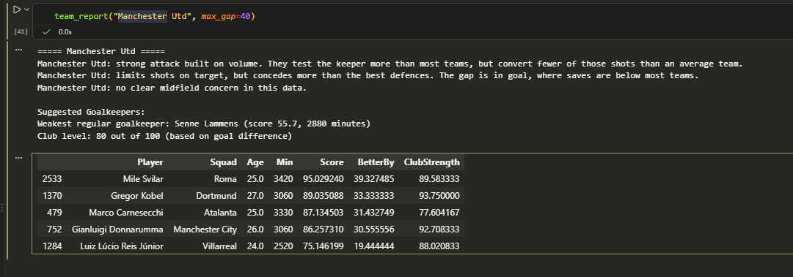

# Football Team Analytics

A notebook-based tool that analyses team and player stats from Europe's top 5 leagues (2025-26 season). It diagnoses where a team is strong or weak, explains why in plain English, and suggests players who could improve the weak area.

## What it does
- Cleans player stats and converts them to per-90-minute numbers
- Ranks players against others in the same role (Forward, Attacking Midfielder, Midfielder, Defender, Goalkeeper), using players with 900+ minutes
- Ranks all 96 teams against each other on each stat (percentiles)
- **Attack diagnosis:** compares how many shots on target a team creates with how many of them go in
- **Defence diagnosis:** compares shots on target faced with goalkeeper save %, to show whether a weakness is in front of the keeper or in goal
- Scores every player for their role and lists low scorers on a team
- **Recommender:** finds the team's weakest regular starter in the role that needs help, then suggests better-scoring players, with filters for age, minutes and how big a jump is realistic
- **Midfield diagnosis:** compares ball winning (tackles won and interceptions) with assists, but only flags a problem when the team's defence or attack is not already strong, so a team that defends well without the ball is not blamed for few tackles

## Example finding
Manchester United score in the top quarter of the 96 teams for goals per match (83rd percentile) and test the keeper more than almost everyone (91st percentile for shots on target), but convert slightly fewer of those shots than an average team. Their defence limits shots on target (82nd percentile) but their goalkeepers save fewer shots than about 80% of teams, so the tool points to goalkeeping and suggests keepers who score higher than their current starter.

## Data
Player stats from the [Football Players Stats 2025-2026](https://www.kaggle.com/datasets/hubertsidorowicz/football-players-stats-2025-2026) dataset on Kaggle.

The CSV is not included in this repository. Download it from Kaggle and place it in the project folder as `players_data-2025_2026.csv`.

## How to run
1. Install the libraries: `pip install -r requirements.txt`
2. Open `explore.ipynb` in VS Code or Jupyter
3. Run all cells from the top
4. Try `team_report("Manchester Utd", max_gap=40)` with any team name

## Web app
The `webapp/` folder holds a Django version of the tool. It has pages for leagues, teams, players, and team reports, so you can browse the same diagnoses and recommendations in the browser instead of the notebook.

To run it (after downloading the CSV as described above):
1. `cd webapp`
2. `python manage.py migrate`
3. `python manage.py import_stats`
4. `python manage.py runserver`
5. Open http://127.0.0.1:8000/ in your browser

## Limitations
- The dataset has no expected-goals (xG), passing, possession or pressing stats, so the tool cannot tell bad finishing from low-quality shots, or judge passing and build-up play.
- Player scores average a few chosen stats with equal weights. Defenders in particular are judged on tackles and interceptions, which also reflect how much of the ball a team has.
- The labels and recommendations use fixed cut-offs, so teams near a cut-off can land on either side.
- Recommendations ignore price, contract, wages, injuries and league strength. They are a shortlist to research, not transfer advice.
- It covers one season of data.
- Club level (goal difference per match) is only a rough stand-in for whether a move is realistic. Player scores are also not adjusted for the quality of the team around them or the strength of the league.

## Planned
- Explore an extra data source for xG and xA, if its terms allow
- Refresh the data automatically during the season